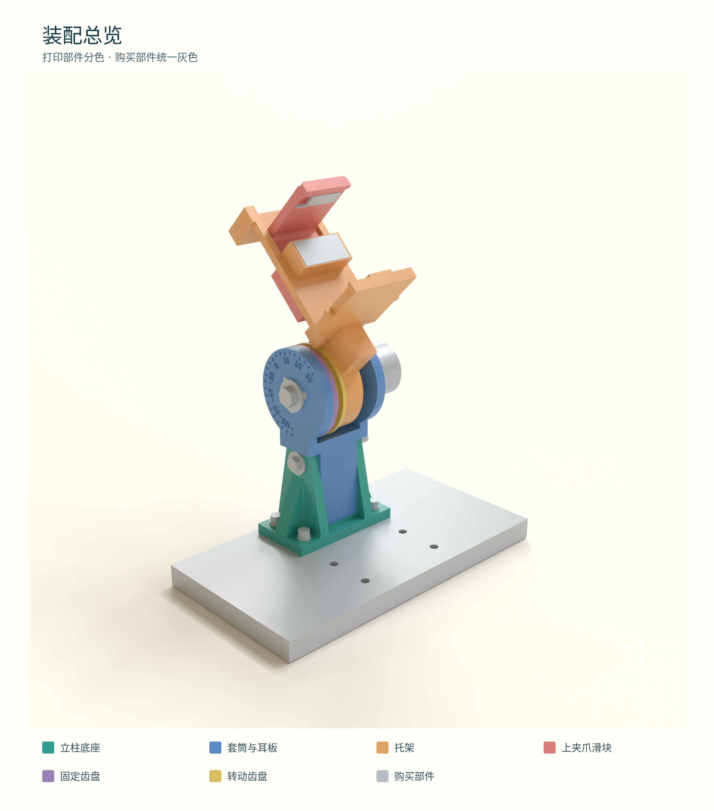
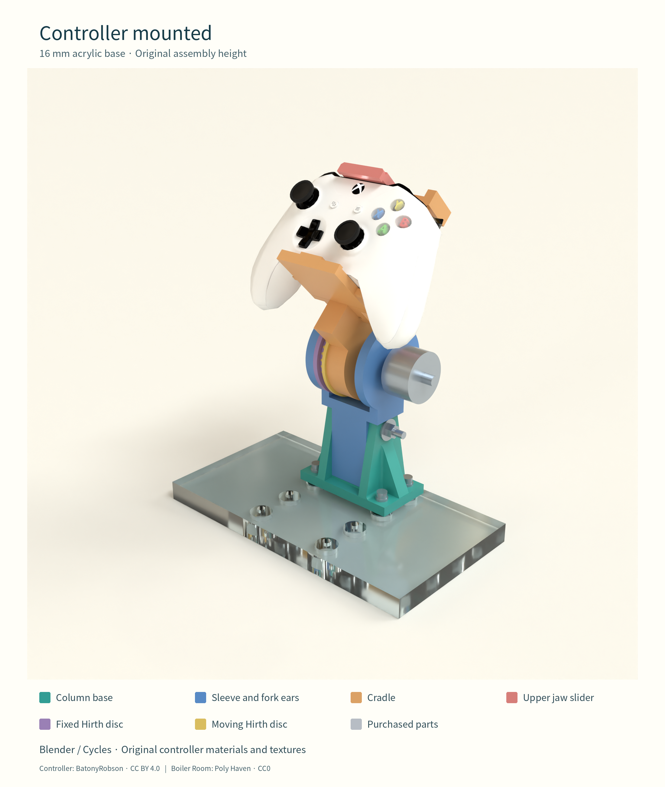
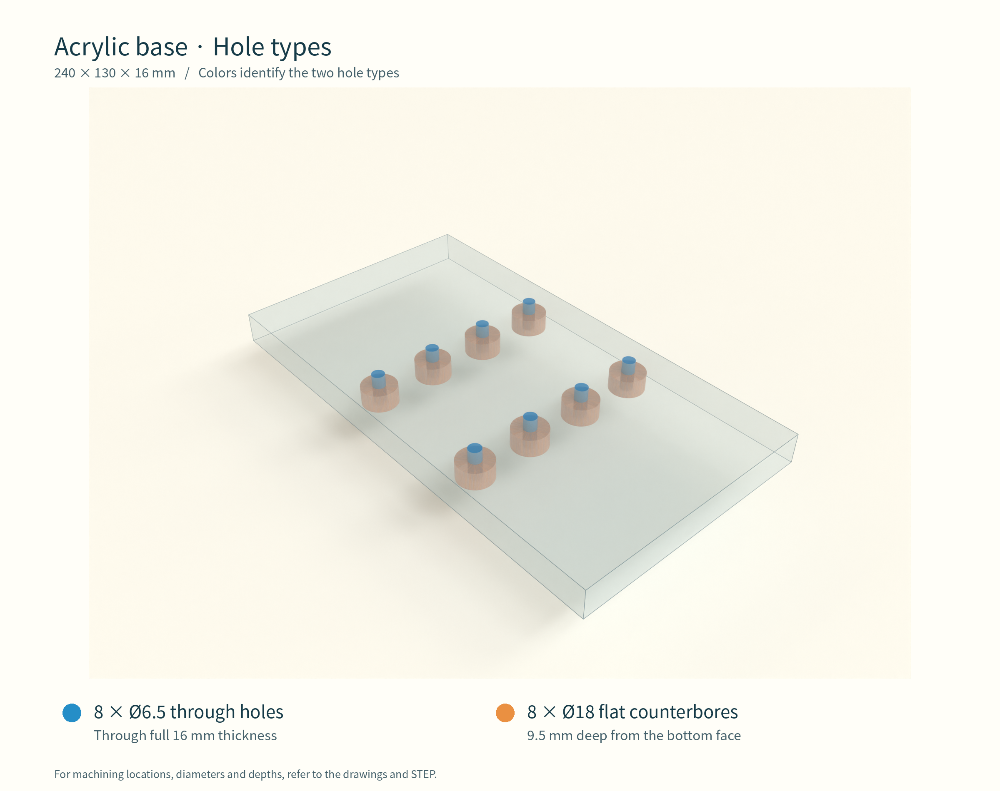

# Gamepad fixture

Editable CAD and manufacturing files for an Xbox One S 1708 controller fixture, with height adjustment, a Hirth tilt coupling and a 16 mm acrylic base.







## Download

The [latest release](https://github.com/5o1/gamepad_fixture/releases/latest) includes the complete STEP assembly, six separate PETG printing files, acrylic machining CAD/DXF, dimensioned paper drawings and an itemized purchasing list. Manufacturing instructions and drawings are currently in Chinese.

- [Complete delivery](https://github.com/5o1/gamepad_fixture/releases/download/v3.3.0/gamepad_fixture_v3.3.0.zip)
- [Printing centre STL bundle](https://github.com/5o1/gamepad_fixture/releases/download/v3.3.0/printing_STL_v3.3.0.zip)
- [Acrylic manufacturer bundle](https://github.com/5o1/gamepad_fixture/releases/download/v3.3.0/acrylic_manufacturing_v3.3.0.zip)

The base is 240 × 130 × 16 mm, with eight Ø6.5 through holes and bottom Ø18 counterbores 9.5 mm deep. The upper assembly stays at its original height. Printed parts and purchased hardware are filed separately; consult the purchasing list before ordering.

## Shared colors and rendering references

[`config/colors.json`](config/colors.json) defines the six printed-part colors.
The printing reference, URDF materials and both assembly images read that same
palette. The mounted view preserves the approved controller PBR materials and
Boiler Room illumination.

- **Printing centre:** [color swatch PDF](https://github.com/5o1/gamepad_fixture/releases/download/v3.3.0/printing_colors.pdf), with per-STL color names, sRGB HEX/RGB and PETG quantities in the printing bundle. Confirm the actual supplier swatch before production.
- **Simulation rendering:** [URDF and all meshes](https://github.com/5o1/gamepad_fixture/releases/download/v3.3.0/simulation_URDF_v3.3.0.zip). This is a fixed visual assembly in metres, not a dynamics/contact model.
- **Presentation rendering:** [approved Blender inputs](https://github.com/5o1/gamepad_fixture/releases/download/v3.3.0/render_inputs_v3.3.0.zip) and [rendering instructions](docs/rendering.md).

See [the color reference guide](docs/color_reference.md) for file locations,
color-space conventions and the update workflow. Production STL files remain
in millimetres; do not use the URDF's metre-scale meshes for printing.

## Build

Python 3.10+ and a CJK font (Noto Sans CJK recommended) are required.

```sh
python -m venv .venv
# Activate the environment, then:
python -m pip install -r requirements.txt
python scripts/build.py
python -m unittest discover -s tests
```

Outputs go to ignored `build/`. The build uses the [editable source CAD](design/README.md) and does not require the parent robotics workspace or a connected printer. [Validation scope](docs/validation.md) explains what has and has not been verified. Blender rendering uses the approved upstream Cycles scene; see [rendering](docs/rendering.md).

## License

Original fixture code and CAD: [MIT](LICENSE), Copyright (c) 2026 **5o1** <assanekowww@gmail.com>.

Controller reference and imagery: **BatonyRobson**, [CC BY 4.0](https://creativecommons.org/licenses/by/4.0/); see [source and notices](THIRD_PARTY_NOTICES.md). The Boiler Room environment is CC0.
