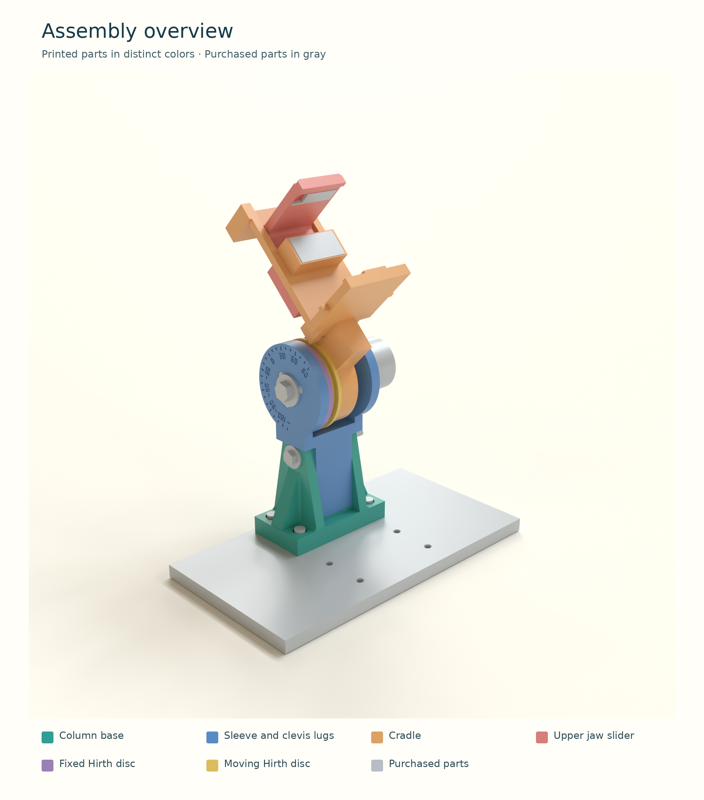
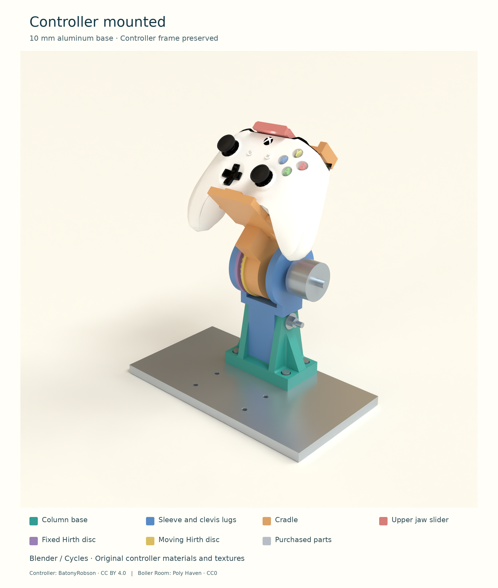
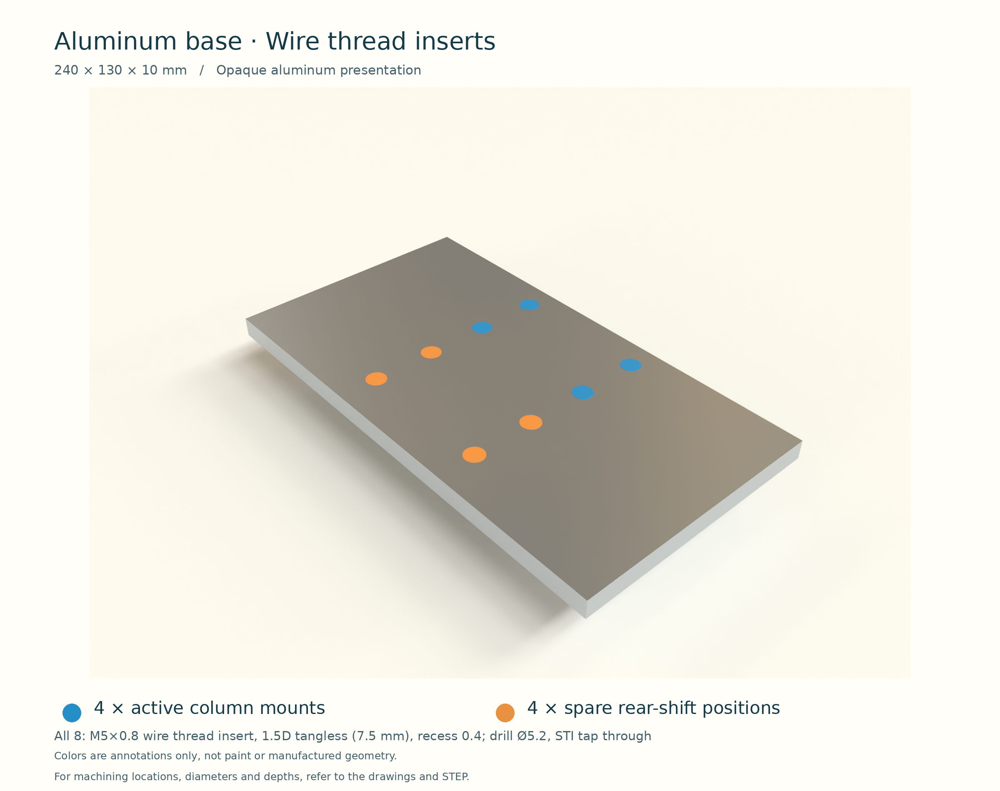

# Gamepad fixture

Editable CAD and manufacturing files for an Xbox One S 1708 controller fixture, with height adjustment, a Hirth tilt coupling and a 10 mm aluminum plate base with M5 wire thread inserts.







## Download

The [latest release](https://github.com/5o1/gamepad_fixture/releases/latest) includes the complete STEP assembly, six separate PETG printing files, aluminum plate machining CAD/DXF, dimensioned drawings and an itemized BOM. All part names and delivery documents are in English.

- [Assembly STEP with controller reference](https://github.com/5o1/gamepad_fixture/releases/download/v3.4.0/assembly_with_controller_v3.4.0.step)
- [Fixture-only assembly STEP](https://github.com/5o1/gamepad_fixture/releases/download/v3.4.0/assembly_v3.4.0.step)
- [Complete delivery](https://github.com/5o1/gamepad_fixture/releases/download/v3.4.0/gamepad_fixture_v3.4.0.zip)
- [Printing center STL bundle](https://github.com/5o1/gamepad_fixture/releases/download/v3.4.0/printing_STL_v3.4.0.zip)
- [Aluminum plate manufacturing bundle](https://github.com/5o1/gamepad_fixture/releases/download/v3.4.0/aluminum_manufacturing_v3.4.0.zip)

The base is a 240 × 130 × 10 mm aluminum plate with eight M5×0.8 wire thread inserts and a flat underside; alloy, temper and finish are left to the supplier. The column base flange extends 6 mm lower than in v3.3 and has four Ø10.4 counterbores, so the controller frame is unchanged. Printed parts and purchased hardware are filed separately; consult the BOM before ordering.

## Shared colors and rendering references

[`config/colors.json`](config/colors.json) defines the six printed-part colors.
The printing reference, URDF materials and both assembly images read that same
palette. The mounted view preserves the approved controller PBR materials and
Boiler Room illumination.

- **Printing center:** [color swatch PDF](https://github.com/5o1/gamepad_fixture/releases/download/v3.4.0/printing_colors.pdf), with per-STL color names, sRGB HEX/RGB and PETG quantities in the printing bundle. Confirm the actual supplier swatch before production.
- **Simulation rendering:** [URDF and all meshes](https://github.com/5o1/gamepad_fixture/releases/download/v3.4.0/simulation_URDF_v3.4.0.zip). This is a fixed visual assembly in metres, not a dynamics/contact model.
- **Presentation rendering:** [approved Blender inputs](https://github.com/5o1/gamepad_fixture/releases/download/v3.4.0/render_inputs_v3.4.0.zip) and [rendering instructions](docs/rendering.md).

See [the color reference guide](docs/color_reference.md) for file locations,
color-space conventions and the update workflow. Production STL files remain
in millimetres; do not use the URDF's metre-scale meshes for printing.

## Build

Python 3.10+ is required. Drawings use the bundled Matplotlib DejaVu Sans font; a CJK font is not required. PDF text validation uses Poppler utilities (`pdfinfo` and `pdftotext`).

```sh
python -m venv .venv
# Activate the environment, then:
python -m pip install -r requirements.txt
python scripts/build.py
python scripts/validate.py --out build/alu10
python -m unittest discover -s tests
```

Outputs go to ignored `build/alu10/`. The build uses the [editable source CAD](design/README.md) and does not require the parent robotics workspace or a connected printer. [Validation scope](docs/validation.md) explains what has and has not been verified. Blender rendering uses the approved upstream Cycles scene; see [rendering](docs/rendering.md).

## License

Original fixture code and CAD: [MIT](LICENSE), Copyright (c) 2026 **5o1** <assanekowww@gmail.com>.

Controller reference and imagery: **BatonyRobson**, [CC BY 4.0](https://creativecommons.org/licenses/by/4.0/); see [source and notices](THIRD_PARTY_NOTICES.md). The Boiler Room environment is CC0.
